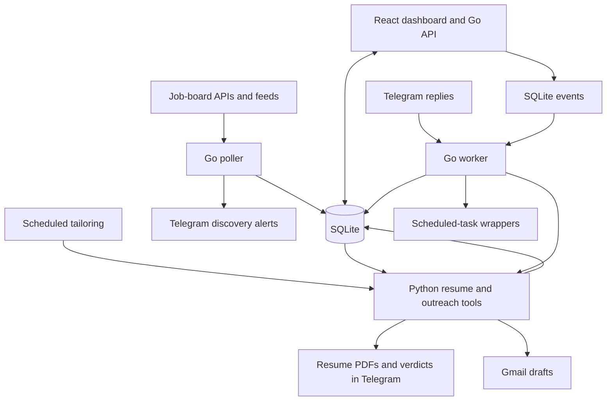

# jobwatch

Watch job boards, filter new roles, tailor resumes, track applications, and draft outreach from a dashboard or Telegram.

I built jobwatch for my own job search. It runs on my server: scheduled jobs collect openings and prepare resumes, a dashboard holds the jobs and their status, and a worker handles Telegram replies and queued actions. I can add a job link, get a tailored PDF, ask for edits, and draft an email without moving the same details between tools.

The polling and tracking work independently of the AI features. Resume generation still contains my own skills, experience, and projects in Python. You can run the tracker with your own sources today; using the resume pipeline requires changing that content too. Making that setup reusable is the next step.

## What it does

- **Collects jobs** from Greenhouse, Lever, Ashby, Workday, RemoteOK, We Work Remotely, Remotive, and Web3Career. Sources and title/location filters live in YAML.
- **Keeps source history in SQLite.** It records polling runs, refreshes known postings, prevents repeat ingestion of the same source ID, and links similar listings for review rather than silently dropping distinct requisitions.
- **Evaluates roles against preferences.** An LLM returns a verdict, preference-fit score, work mode, and explanation. If the LLM is unavailable, the verdict falls back to keyword coverage and leaves preference fit unknown.
- **Builds tailored resume PDFs.** It selects and orders curated skills and experience for a job, compiles LaTeX with Tectonic, and checks that the result is one page.
- **Accepts jobs you find elsewhere.** Submit a URL in the dashboard or send it to the bot. The dashboard also accepts pasted or uploaded job-description text when the page cannot be fetched.
- **Tracks applications** with statuses, notes, and history. Update them from the dashboard or by replying to a Telegram notification.
- **Prepares outreach.** Import LinkedIn connections, see contacts at a company, generate or revise an email, save it as a Gmail draft, and send it after confirmation in the dashboard. Founder outreach can also create a draft after tailoring, subject to its lookup and company filters.
- **Shows background work.** The Cron page displays scheduled-job status and the event queue, with actions to run supported tasks immediately.

Jobwatch does not submit applications to company portals. Generated resumes and emails need your review.

## How the parts fit together



The Go binary provides the poller, HTTP API, Telegram listener, and event worker. The React dashboard is built with Vite and embedded in that binary. Python handles job-description extraction, resume construction, LLM calls, and Gmail integration. The shell scripts load the environment and run those tools on Linux.

`serve` and `worker` are separate processes. The dashboard enqueues manual tailoring, founder outreach, and scheduled-task actions; the worker executes them. Telegram updates and their polling offset are stored together before processing. Interrupted events are recovered on worker startup; handler errors remain visible as failures rather than being blindly retried.

Polling and batch tailoring need an external scheduler. Running the worker alone does not schedule them. The email composer calls its Python helper directly through the Go API.

## Run the tracker locally

The commands below use Bash on Linux or WSL. Build requirements are Go 1.25+, Node.js 22.12+ and npm, plus `make` for the build shortcut. Python and the PDF tools are only needed for tailoring and email features.

### 1. Build

```sh
git clone https://github.com/mayurathavale18/jobwatch.git
cd jobwatch
make build
```

This builds the frontend into `internal/web/dist`, then compiles `bin/jobwatch`. To run the build steps separately:

```sh
cd frontend
npm ci
npm run build
cd ..
go build -o bin/jobwatch ./cmd/jobwatch
```

### 2. Choose your sources and filters

Edit [config.yaml](config.yaml). It contains the sources and filters used for my search, so review them before polling. For local use, set the dashboard address to loopback:

```yaml
dashboard:
  addr: "127.0.0.1:8787"
db_path: "./jobwatch.db"
```

The checked-in address is `0.0.0.0:8787` for the deployed container. The application has no built-in authentication; keep a local instance on loopback, or put authentication in front of it when hosting it.

### 3. Seed the database and open the dashboard

```sh
./bin/jobwatch backfill -config config.yaml
./bin/jobwatch serve -config config.yaml
```

Open [localhost:8787](http://127.0.0.1:8787). Backfill records existing jobs without sending discovery notifications. To collect later openings, run this in another terminal or schedule it:

```sh
./bin/jobwatch poll -config config.yaml
```

Without Telegram credentials, polling still stores jobs and logs that notifications are disabled. The dashboard can browse jobs and update statuses without a worker. Queued actions need the worker and the tools required by each action.

## Add Telegram

Create your own bot through **@BotFather**, start a conversation with it, and obtain your chat ID. Before starting the worker, you can inspect the bot's `getUpdates` response to find the `message.chat.id` field. Use a separate bot for development if another instance is already consuming updates.

Copy [.env.example](.env.example) to `.env` and replace the example values:

```sh
cp .env.example .env
# Edit .env, then load it into this shell:
set -a
source .env
set +a
```

The Go commands read exported environment variables; they do not load `.env` themselves. The worker and tailoring shell wrappers load it for you.

```sh
./bin/jobwatch test-notify -config config.yaml
bash scripts/worker.sh
```

`test-notify` sends a real message. Keep the worker running alongside the dashboard. Run all processes from the repository root so they share the same database and scripts.

**Run one worker per bot.** Do not run `tg-sync` or a second worker against that bot at the same time; both consume Telegram updates. Do not run independent polling installations against the same bot with separate databases either, as each will consider jobs new.

Reply directly to a job notification:

| Reply | Action |
|---|---|
| `applied`, `done` | Mark applied |
| `shortlist`, `later` | Mark shortlisted |
| `skip`, `ignore` | Mark ignored |
| `rejected`, `interview`, `offer` | Set that status |
| `new`, `reset` | Set status back to new |
| `note: applied through a referral` | Append a timestamped note |
| `fix` | Rebuild the tailored resume |
| `fix: emphasize backend work` | Rebuild with an edit instruction |
| `update: shorten the summary` | Edit the cached resume content |
| `outreach` or `outreach: person@example.com` | Run founder outreach, optionally with a supplied recipient |

Resume and outreach replies need the Python setup below. Send a bare job URL as a new message to add a manual job. If automated extraction fails, use the dashboard to supply the description.

## Set up resumes and email

Install Python 3, [Tectonic](https://tectonic-typesetting.github.io/), and Poppler's `pdfinfo`. On Ubuntu, Tectonic also needs `libgraphite2-3`. The main Python scripts use the standard library.

Before enabling tailoring, replace the candidate content:

| File | What it controls |
|---|---|
| [resume/master.tex](resume/master.tex) | LaTeX structure and contact details; keep the section anchors used by the generator |
| [resume/preferences.md](resume/preferences.md) | Search preferences passed into the LLM judgment |
| [resume/facts.md](resume/facts.md) | Candidate evidence maintained alongside the generator; editing it alone does not update the generated resume |
| [scripts/tailor_resume.py](scripts/tailor_resume.py) | Active skill tiers, experience bullets, projects, output naming, role/experience filters, and batch limits |

The generator currently assumes an engineering search and includes a three-year required-experience ceiling. Review those rules along with the content. The Go CLI supports a custom database path, but the Python tools currently expect `jobwatch.db` in the repository root.

Add credentials to your local `.env` for the features you want:

| Variables | Used for |
|---|---|
| `JOBWATCH_TG_TOKEN`, `JOBWATCH_TG_CHAT` | Discovery alerts, resume delivery, and bot replies |
| `WEB3CAREER_API_TOKEN` | Web3Career feed |
| `OPENCODE_API_KEY` | OpenCode-hosted LLM calls for extraction fallback, verdicts, and email generation/revision |
| `GMAIL_CLIENT_ID`, `GMAIL_CLIENT_SECRET`, `GMAIL_REFRESH_TOKEN` | Gmail drafts and dashboard sending |
| `APOLLO_API_KEY` | Company/person lookup for founder outreach |

`.env.example` only contains the Telegram entries; add the others as needed. Keep `.env` and personal runtime data out of commits. LLM features send job and candidate text to the configured external service; a self-hosted dashboard does not make those calls local.

For Gmail, [scripts/gmail_auth_setup.py](scripts/gmail_auth_setup.py) provides the one-time OAuth flow. The [outreach setup notes](docs/superpowers/specs/2026-07-27-founder-outreach-design.md) describe the credentials. The Apollo free-tier setup used here cannot return founder email addresses; supply a verified recipient through the dashboard or an `outreach:` reply when lookup is unavailable. The email composer also supports saving a draft with the recipient left blank.

After personalization and tool setup, run a batch with:

```sh
bash scripts/tailor-resume-wrapper.sh
```

The worker can also process a manual job from the dashboard. Import a LinkedIn data-export `Connections.csv` on the Connections page to make company contacts available in the email composer.

### Current limits

- Discovery alerts and tailored-resume alerts are separate. A discovery alert has passed title/location filters, not the later LLM judgment.
- Batch tailoring suppresses its notification when known preference fit is below 45. Manual submissions bypass that threshold, and an unknown fit is not a rejection.
- A successful compile and one-page check do not verify every resume claim, visual layout, or ATS parsing result. Review the PDF and any instruction-driven edits.
- The batch skips a job once it has any entry in `resume/tailored.json`, including a failure. Use a manual rebuild to retry it.
- PDFs currently go under the process user's `~/Documents/mayur-athavale-resume`. In a container, that directory needs persistent storage if the files must survive restarts or be available to a different pod for email attachments.
- Evidence-ledger, classifier, and ranking experiments are advisory or shadow paths. They are not the normal eligibility or resume-generation engine.

## Add a source

Each entry in `config.yaml` needs `name`, `provider`, and `slug`:

```yaml
companies:
  - name: "Stripe"
    provider: greenhouse
    slug: stripe
  - name: "Wells Fargo"
    provider: workday
    slug: wf
    host: wd1
    site: WellsFargoJobs
  - name: "Remotive"
    provider: remotive
    slug: remotive
```

For company boards, find the slug in the careers URL or its network requests:

| Provider | Board or endpoint shape |
|---|---|
| `greenhouse` | `boards-api.greenhouse.io/v1/boards/{slug}/jobs` |
| `lever` | `jobs.lever.co/{slug}` |
| `ashby` | `jobs.ashbyhq.com/{slug}` |
| `workday` | `{slug}.{host}.myworkdayjobs.com/wday/cxs/{slug}/{site}/jobs` |

Verify the actual board before adding it. Workday requires both `host` and `site`, and collection is capped at 300 postings per source per poll.

`remoteok`, `wwr`, `remotive`, and `web3career` return jobs across companies. Their slug is a required config label, not a company board ID. Web3Career requires its API token. A feed is not guaranteed to cover every opening.

For an unsupported or blocked site, submit a URL and description manually. Jobwatch has no headless-browser scraping or automatic application submission.

## Commands

Run these from the repository root. Each accepts `-config path/to/config.yaml`.

| Command | Behavior |
|---|---|
| `jobwatch backfill` | Fetch and record existing jobs without discovery notifications |
| `jobwatch poll` | Run one collection cycle, store jobs, and notify on new filter matches |
| `jobwatch serve` | Serve the dashboard and JSON API |
| `jobwatch worker` | Long-poll Telegram and process queued events until stopped |
| `jobwatch refilter` | Reapply current filters to `new` jobs; mark failures ignored |
| `jobwatch test-notify` | Send a real test Telegram message |
| `jobwatch tg-sync` | Consume Telegram updates once; never run alongside the worker |
| `jobwatch import-jobs -file alerts.json` | Preview a structured job import; add `-apply` to write it without notifications |

## Scheduling and deployment

My deployment runs on a single Contabo server with k3s: separate dashboard and worker Deployments, shared code/data on a persistent volume, and CronJobs for polling, tailoring, summaries, and backups. The worker uses one replica and the `Recreate` strategy so two pods do not consume the same bot's updates.

The [deployment workflow](.github/workflows/deploy.yml) builds the frontend, copies source into the persistent volume, rebuilds the Go binary, and restarts the dashboard and worker when `master` changes. It is specific to my server; it is not an installer for a new deployment. [HANDOFF.md](HANDOFF.md) and [CLAUDE.md](CLAUDE.md) contain the operations notes.

You can run the same processes on a Linux machine without Kubernetes. Keep `serve` and `worker` supervised, and schedule `scripts/poll-wrapper.sh` and, once configured, `scripts/tailor-resume-wrapper.sh`. Create `logs/` before redirecting scheduler output there. The Cron page's displayed schedules are descriptive; it does not install or edit a scheduler.

The old `deploy/setup.sh`, systemd service, and `deploy/crontab.example` predate the worker. The crontab still references removed Telegram-sync/watchdog scripts. Do not install that template unchanged.

Back up the shared state, including SQLite and `resume/tailored.json`. SQLite uses WAL mode: use its backup API, or stop writers and checkpoint before copying the database; copying only a live `.db` file can miss uncheckpointed data.

## Development

| Path | Responsibility |
|---|---|
| `cmd/jobwatch/` | CLI commands and worker-handler wiring |
| `internal/providers/` | Source adapters normalized into a common `Job` type |
| `internal/poller/` | Collection, filters, source refresh, and discovery notifications |
| `internal/store/` | SQLite schema, jobs, history, connections, and queue persistence |
| `internal/eventq/`, `internal/tgsync/` | Event execution and Telegram handling |
| `internal/web/`, `frontend/src/` | HTTP API, embedded dashboard, and React source |
| `scripts/` | Resume/email tools, scheduled wrappers, and evaluation experiments |
| `resume/` | Template, candidate evidence, preferences, and ignored runtime state |

Build the frontend before running Go tests in a fresh checkout; `go:embed` needs `internal/web/dist` to exist. The Python tests require `pytest` in your development environment.

```sh
make build
go test ./...
gofmt -l .
python3 -m pytest scripts
```

Run Python tests in a separate checkout without personal data. The existing `test_process_job_skips_over_experience_role` still uses the checkout's database instead of a temporary fixture; it fails with `no such table: jobs` on a fresh checkout.

For frontend development, run `npm run dev` in `frontend/` alongside the Go server. A new source adapter implements `Provider.Fetch(ctx, company)` and needs registration, config validation, and fixture-based tests.

## Next steps

The work ahead is to make this usable beyond my own search:

1. Move candidate content and search rules into a shared profile/configuration model, with an architecture other developers can follow.
2. Make customization work through the dashboard or an agent, with consistent validation for both.
3. Expose Jobwatch through MCP, with skills and slash-command workflows for AI harnesses.
4. Improve the dashboard's navigation, forms, feedback, and accessibility using Impeccable's UI guidance.

These are planned changes. This repo does not ship an MCP server, harness plugin, or profile-setup UI yet.
